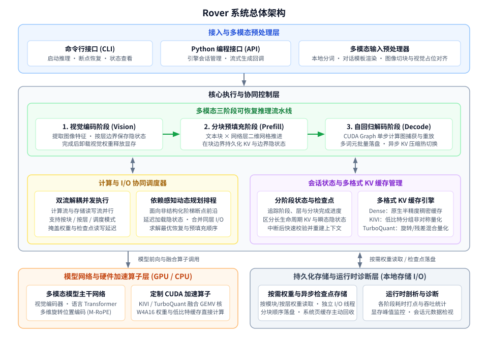

# Rover 技术方案说明

Rover 是一款支持断点恢复的本地多模态大模型推理引擎，专为算力卫星等边缘推理应用场景或本地单机环境设计。它在提供图文多模态推理能力的同时，将推理过程中的关键状态持久化到本地存储，使推理任务能够在暂停或意外中断后从断点处直接恢复，而无需从头重新计算。

---

## 背景与定位

在边缘端或受限算力设备（如嵌入式 GPU 模组、星载或车载计算节点、本地工作站）上运行多模态大模型时，通常会面临三类现实挑战：

- **长耗时任务易受中断影响**：多图输入或长文本提示词的预填充（Prefill）与生成耗时较长，一旦遭遇高优先级任务抢占、进程重启或供电波动，传统推理引擎只能丢弃全部已有进度，从零开始重新推理。
- **峰值显存与内存受限**：多模态模型同时包含视觉编码器与语言主干网络，若一次性全量常驻显存并保存完整键值缓存（KV Cache），极易超出边缘设备的内存上限。
- **部署栈冗重**：主流服务端推理框架通常面向高并发集群设计，依赖复杂、体积庞大，不适合单机离线或嵌入式环境直接集成。

针对上述问题，Rover 的定位是**面向单机与边缘场景的轻量级、可恢复多模态推理引擎**。它摒弃了复杂的服务化依赖，围绕“状态可持久化、资源按需占用、计算与存储协同”三个核心原则构建，在有限硬件资源下提供可靠、可控的本地推理能力。

---

## 功能特性

- **图文多模态推理**：支持纯文本及单图、多图混合输入（当前主要支持 Qwen3-VL 系列模型），所有权重与分词、图像预处理配置均从本地加载，可完全离线运行。
- **会话级断点保存与恢复**：支持在指定生成步数后主动暂停，或在任务中断后基于会话目录直接恢复执行，自动复用已完成的视觉特征、预填充进度与历史上下文缓存。
- **分块预填充与灵活调度**：支持将长输入切分为固定大小的块（Chunk）逐步推进，并提供按块优先、按层优先及计算与存储重叠调度等多种执行策略。
- **多格式 KV 缓存压缩**：除标准全精度/半精度缓存（Dense）外，内置 KIVI 与 TurboQuant 两种低比特量化缓存方案，大幅降低长上下文推理的显存占用与落盘体积。
- **解码图加速**：支持在 GPU 上捕获并重放单步解码计算图（CUDA Graph），显著降低自回归生成阶段的内核启动与调度开销。
- **双形态接入**：同时提供命令行工具与简洁的 Python 编程接口，便于脚本调用或嵌入上层业务系统。

---

## 系统架构

Rover 采用三层协同架构，自上而下由**接入与多模态预处理层**、**核心执行与协同控制层**以及底层的**计算与持久化存储支撑层**组成：



1. **接入与多模态预处理层**  
   负责对外提供命令行（CLI）与 Python 编程接口（API），并完成本地多模态输入准备。包括对话模板渲染、文本分词，以及将输入图像按模型要求缩放、切块并对齐到文本序列的视觉占位符。
2. **核心执行与协同控制层**  
   作为引擎的中枢，围绕**多模态三阶段可恢复推理流水线**（视觉编码 → 分块预填充 → 自回归解码）展开，并通过两大核心控制机制协同工作：
   - **计算与 I/O 协同调度器**：将“文本块 × 网络层”二维网格中的模型计算与磁盘读写拆分为两条独立资源流并发执行，并针对中断后的非结构化阶梯断点前沿，通过动态规划（DP）求解最优的层权重与状态恢复顺序，最大限度掩盖存储读写延迟。
   - **会话状态与多格式 KV 缓存管理**：追踪各阶段、各层与各分块的执行进度，针对不同阶段的状态生命周期特征（瞬态隐状态与持久化 KV 缓存）按需提交检查点，同时统一管理稠密（Dense）与低比特量化（KIVI、TurboQuant）KV 缓存。
3. **底层计算与持久化存储支撑层**
   - **模型网络与硬件加速算子层（GPU / CPU）**：承载视觉编码器、语言 Transformer 主干与多维旋转位置编码（M-RoPE）的前向计算，并通过定制的 CUDA 融合矩阵向量乘（GEMV）算子直接在低比特量化缓存上完成高效注意力计算。
   - **持久化存储与运行时诊断层（本地存储 I/O）**：负责模型权重的按模块/按层按需加载，以及通过独立后台 I/O 线程完成检查点的分块顺序落盘与系统页缓存主动回收，同时提供阶段耗时打点与显存峰值监控。

---

## 关键设计

### 分阶段可恢复执行流

Rover 将一次完整的推理请求拆解为连续的生命周期阶段：**视觉与输入准备**、**预填充**、**解码准备**以及**自回归解码**。

- 在**视觉与输入准备阶段**，引擎仅加载词嵌入与视觉编码器，完成图像特征提取与多模态输入融合，并将结果持久化到会话目录；一旦完成，视觉编码器占用的显存即可释放。
- 在**预填充阶段**，引擎按配置的粒度逐步推进上下文计算，持续将各层产生的键值缓存与必要的中间状态同步到存储层。
- 在**解码准备与自回归解码阶段**，引擎收敛或转换预填充生成的缓存格式，随后进入逐词生成循环。每生成一个新词元并完成状态提交后，当前进度即具备可恢复性。

当会话从断点恢复时，引擎先读取会话元数据，识别上次已提交的阶段与层/块进度，直接跳过已完成的视觉编码或前序预填充步骤，仅恢复必要的上下文状态并继续后续计算。

### 按需权重加载与显存控制

为降低边缘设备上的内存压力，Rover 不会在启动时盲目分配并常驻所有模型组件：

- **构建与加载分离**：先在不分配实际物理内存的情况下建立网络结构，再根据当前所处的执行阶段按需从本地权重文件中加载对应模块。
- **阶段性内存回收**：视觉编码器仅在多模态输入准备阶段加载，编码一结束即立即卸载并回收显存池，把显存完整让渡给后续的语言模型预填充与长序列解码。
- **按层流式执行**：在受限内存或特定调度模式下，语言模型的各层权重可以配合调度策略按层读取与使用，从而用存储带宽换取更低的驻留内存。

### 预填充计算与存储协同调度

在需要频繁持久化状态的场景下，如果每次计算完都同步等待磁盘写入，存储读写将成为显著的性能瓶颈。Rover 将预填充网格中的工作拆分为**计算任务**和**读写任务**两类独立资源流：

- **按块优先（Chunk-first）**：按输入序列的分块顺序逐块贯穿所有网络层，内存中只需保留当前块的激活值，每个分块完成后提交一次进度，兼顾低内存占用与定期检查点。
- **按层优先（Layer-first）**：按网络层顺序依次处理完整序列，并在层间持久化中间状态，适合按层流水与层权重复用场景。
- **协同调度（Scheduled）**：调度器同时维护计算队列与读写队列，在 GPU/CPU 执行当前单元计算的同时，后台并发预取下一批权重或异步刷写上一单元的缓存与中间状态；同时支持基于动态规划的调度策略，根据计算耗时与读写代价自动规划最优执行顺序。

### 多格式 KV 缓存与异步压缩

随着上下文长度增长，KV 缓存既占用大量显存，也会增加断点持久化的读写开销。Rover 提供三种缓存策略以适配不同需求：

- **Dense（稠密缓存）**：以标准半精度格式保存键值向量，无需编译额外算子，兼容 CPU 与各类 GPU，适合短上下文或对数值一致性要求极高的场景。
- **KIVI（分组非对称量化）**：对历史键值向量进行低比特（如 2-bit）分组量化并紧凑打包存储，同时保留近期词元的残差窗口，在几乎不影响生成质量的前提下显著缩减缓存体积。
- **TurboQuant（旋转与残差混合量化）**：结合随机正交旋转、标量量化与残差编码，并支持**异步重叠压缩**——预填充结束后无需停顿等待历史缓存量化，引擎可先基于稠密缓存立即开始解码输出，同时在后台完成历史缓存压缩，完成后平滑切换至量化缓存继续解码，兼顾首字延迟与长序列吞吐。

---

## 使用指南

### 环境准备

Rover 依赖 Python 3.10–3.13 及 `uv` 工具链。在常规环境中可通过以下命令完成安装：

```bash
git clone https://github.com/OPEN-TianSuan/Rover.git
cd Rover
uv sync
```

在 NVIDIA Jetson Orin（JetPack 6 / CUDA 12.6）设备上，可使用内置初始化脚本安装适配硬件的依赖环境：

```bash
python3 scripts/setup_jetson.py
```

若需使用 KIVI 或 TurboQuant 量化缓存，需编译配套的 CUDA 算子扩展（仅使用默认 Dense 缓存时无需执行）：

```bash
uv run python scripts/build_kernels.py
```

### 命令行调用

每次发起新请求时，需指定本地模型目录（`--model`）以及一个空目录作为会话状态目录（`--state-dir`）。

**文本推理：**

```bash
uv run rover generate \
  --model /path/to/Qwen3-VL-2B-Instruct \
  --prompt '用两句话解释为什么天空是蓝色的。' \
  --state-dir runs/text-demo \
  --device cuda \
  --max-new-tokens 128
```

**图文多模态推理（可多次传入 `--image` 附带多张图片）：**

```bash
uv run rover generate \
  --model /path/to/Qwen3-VL-2B-Instruct \
  --prompt '描述这张图片中的主要内容。' \
  --image /path/to/photo.jpg \
  --state-dir runs/image-demo \
  --device cuda \
  --max-new-tokens 128
```

**暂停与断点恢复：**

```bash
# 生成 16 个词元后主动保存状态并暂停
uv run rover generate \
  --model /path/to/Qwen3-VL-2B-Instruct \
  --prompt '写一个关于迷路机器人的短篇故事。' \
  --state-dir runs/story-demo \
  --device cuda \
  --max-new-tokens 128 \
  --stop-after-tokens 16

# 从已保存的会话目录直接恢复并继续生成
uv run rover resume --state-dir runs/story-demo
```

此外，可通过 `uv run rover inspect --state-dir runs/story-demo` 在不加载模型权重的情况下查看会话当前的保存进度与配置元数据。

### Python 接口调用

Rover 可作为 Python 库直接嵌入应用程序中：

```python
from rover.engine import Engine
from rover.processing import Processor

model_dir = "/path/to/Qwen3-VL-2B-Instruct"
processor = Processor(model_dir)

# 编码纯文本；若包含图片可传入路径列表：processor.encode(prompt, ["/path/to/photo.jpg"])
inputs = processor.encode("用一句话介绍你自己。")

with Engine.create(
    model_dir,
    "runs/python-demo",
    device="cuda",
    max_new_tokens=128,
    **inputs,
) as engine:
    tokens = engine.generate()
    print(processor.decode(tokens))
```

如需在代码中恢复未完成的会话，使用 `with Engine.resume("runs/python-demo") as engine:` 并调用 `engine.generate()` 即可。

### 常用参数说明

| 参数                    | 说明                                                                           |
| :-------------------- | :--------------------------------------------------------------------------- |
| `--device`            | 指定运行设备（如 `cuda` 或 `cpu`）。                                                    |
| `--max-new-tokens`    | 最大生成的词元数量。                                                                   |
| `--chunk-size`        | 预填充阶段单次分块处理的词元数量。                                                            |
| `--prefill-order`     | 预填充执行模式，可选 `chunk_first`、`layer_first` 或 `scheduled`。                        |
| `--strategy`          | 协同调度模式下的排程策略（如 `chunk_first`、`layer_first`、`greedy`、`state_compression_dp`）。 |
| `--cache-format`      | KV 缓存存储格式，可选 `dense`、`kivi` 或 `turboquant`。                                  |
| `--cuda-graph`        | 在支持的 GPU 解码路径上启用 CUDA Graph 加速。                                              |
| `--stop-after-tokens` | 生成指定数量词元并提交检查点后自动暂停。                                                         |

---

## 约束与限制

- **单会话单请求**：引擎面向本地与边缘端设计，每次执行处理单个请求（Batch Size 为 1），且同一会话目录不支持多进程并发读写。
- **输入模态范围**：当前支持文本与静态图片输入，暂未内置视频流直接解码。
- **恢复边界语义**：断点恢复以最近一次完成持久化的提交点为准，不提供硬件突发掉电瞬间的任意指令级恢复保证。
- **异步压缩的确定性**：在启用 TurboQuant 异步后台压缩时，缓存格式的切换时机取决于运行时并发进度；若中途暂停并恢复，切换点可能发生偏移从而引起后续生成结果的细微差异。对复现一致性有严格要求时，建议使用 `dense` 或同步量化模式。
