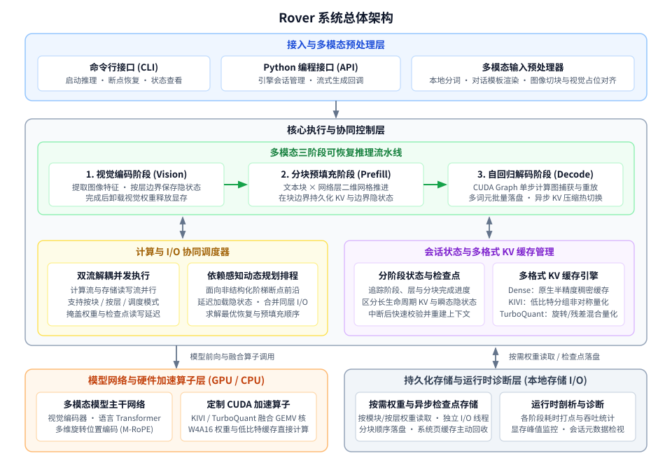

# Rover Technical Architecture

Rover is a local multimodal large language model inference engine with checkpoint and resume support, designed for edge inference scenarios such as onboard satellite computing and local standalone environments. Alongside text-and-image inference, it persists critical inference state to local storage, allowing tasks to resume directly from a checkpoint after a pause or unexpected interruption without recomputing from scratch.

---

## Background and Scope

Running multimodal large language models on edge or resource-constrained devices, such as embedded GPU modules, satellite or vehicle computing nodes, and local workstations, typically presents three practical challenges:

- **Long-running tasks are vulnerable to interruptions**: Prefill and generation for multiple images or long text prompts can be time-consuming. When preempted by higher-priority tasks, interrupted by process restarts, or affected by power fluctuations, conventional inference engines must discard all progress and restart inference from scratch.
- **Limited peak GPU and system memory capacity**: Multimodal models include both a vision encoder and a language backbone. Keeping all components resident in GPU memory together with the full key-value (KV) cache can easily exceed the memory capacity of edge devices.
- **Heavy deployment stacks**: Mainstream server-side inference frameworks are typically designed for highly concurrent clusters. Their complex dependencies and large footprints make them difficult to integrate directly into standalone offline or embedded environments.

Rover addresses these challenges as a **lightweight, resumable multimodal inference engine for standalone and edge environments**. It avoids complex serving dependencies and is built around three core principles: persistent state, on-demand resource allocation, and coordinated compute and storage. These principles enable reliable, controllable local inference on limited hardware.

---

## Features

- **Text-and-image multimodal inference**: Supports text-only input and text combined with one or more images, currently focusing on the Qwen3-VL model family. All weights, tokenizer configurations, and image preprocessing configurations are loaded locally, enabling fully offline operation.
- **Session-level checkpointing and resumption**: Supports explicit pauses after a specified number of generation steps and direct resumption from a session directory after interruption, automatically reusing computed visual features, prefill progress, and cached context.
- **Chunked prefill and flexible scheduling**: Splits long inputs into fixed-size chunks for incremental processing, with execution strategies including chunk-first, layer-first, and scheduling that overlaps compute with storage I/O.
- **Multiple KV cache compression formats**: In addition to standard full-precision and half-precision caching (Dense), includes KIVI and TurboQuant low-bit quantized cache formats to substantially reduce GPU memory usage and on-disk size for long-context inference.
- **CUDA Graph acceleration for decoding**: Captures and replays single-step decoding computation graphs on the GPU, significantly reducing kernel launch and scheduling overhead during autoregressive generation.
- **CLI and Python interfaces**: Provides both command-line tools and a concise Python API for scripting and integration into higher-level applications.

---

## System Architecture

Rover uses a coordinated three-tier architecture, comprising the **interface and multimodal preprocessing tier**, the **core execution and coordination tier**, and the underlying **compute and persistent storage support tier**:



1. **Interface and Multimodal Preprocessing Tier**  
   Exposes the command-line interface (CLI) and Python API and prepares local multimodal inputs. This includes chat template rendering, text tokenization, and resizing and patching input images according to model requirements, then aligning them with visual placeholders in the text sequence.
2. **Core Execution and Coordination Tier**  
   Forms the engine's core around a **three-stage resumable multimodal inference pipeline** (vision encoding → chunked prefill → autoregressive decoding), coordinated by two principal control mechanisms:
   - **Compute and I/O Scheduler**: Separates model computation and disk I/O in the two-dimensional grid of text chunks × network layers into two independent, concurrently executing resource streams. For the irregular, staircase-shaped checkpoint frontier left by an interruption, dynamic programming (DP) determines the optimal order for restoring layer weights and state to hide storage I/O latency as much as possible.
   - **Session State and Multi-Format KV Cache Management**: Tracks execution progress across stages, layers, and chunks. Commits checkpoints as needed according to the state lifecycles of each stage, including transient hidden states and persistent KV caches, while providing unified management of dense and low-bit quantized (KIVI and TurboQuant) KV caches.
3. **Compute and Persistent Storage Support Tier**
   - **Model Networks and Hardware-Accelerated Operators (GPU / CPU)**: Executes forward computation for the vision encoder, language Transformer backbone, and multidimensional rotary positional embeddings (M-RoPE). Custom fused CUDA matrix-vector multiplication (GEMV) kernels enable efficient attention computation directly on low-bit quantized caches.
   - **Persistent Storage and Runtime Diagnostics (Local Storage I/O)**: Loads model weights on demand by module or layer. A dedicated background I/O thread writes checkpoints sequentially in chunks and proactively reclaims the operating system's page cache. This tier also provides per-stage timing instrumentation and peak GPU memory monitoring.

---

## Key Design Decisions

### Resumable Execution by Stage

Rover divides a complete inference request into consecutive lifecycle stages: **vision and input preparation**, **prefill**, **decode preparation**, and **autoregressive decoding**.

- During **vision and input preparation**, the engine loads only the token embeddings and vision encoder, extracts image features, fuses multimodal inputs, and persists the results to the session directory. Once this stage completes, the GPU memory occupied by the vision encoder can be released.
- During **prefill**, the engine incrementally processes the context at the configured granularity, continuously synchronizing each layer's KV cache and required intermediate state to storage.
- During **decode preparation and autoregressive decoding**, the engine consolidates or converts the cache format produced during prefill, then enters the token-by-token generation loop. Progress becomes resumable after each new token is generated and the corresponding state is committed.

When resuming a session from a checkpoint, the engine first reads the session metadata to identify the last committed stage and layer/chunk progress. It skips completed vision encoding and earlier prefill steps, restores only the required context state, and continues the remaining computation.

### On-Demand Weight Loading and GPU Memory Management

To reduce memory pressure on edge devices, Rover does not allocate all model components and keep them resident at startup:

- **Separate construction from loading**: Constructs the network structure without allocating physical memory, then loads the required modules from local weight files on demand according to the current execution stage.
- **Reclaim memory between stages**: Loads the vision encoder only during multimodal input preparation. Immediately after encoding, it unloads the encoder and reclaims its GPU memory pool, making that memory available for subsequent language model prefill and long-sequence decoding.
- **Stream execution layer by layer**: Under memory constraints or in specific scheduling modes, language model weights can be read and used one layer at a time according to the scheduling strategy, trading storage bandwidth for a smaller resident memory footprint.

### Coordinated Compute and Storage Scheduling for Prefill

When state must be persisted frequently, synchronously waiting for disk writes after every computation can make storage I/O a significant bottleneck. Rover separates work in the prefill grid into two independent resource streams: **compute tasks** and **I/O tasks**:

- **Chunk-first**: Processes input chunks in sequence, passing each chunk through all network layers. Only the current chunk's activations need to remain in memory. Progress is committed after each chunk completes, combining low memory usage with periodic checkpointing.
- **Layer-first**: Processes the full sequence one network layer at a time and persists intermediate state between layers. This is suitable for layer-wise pipelining and layer weight reuse.
- **Scheduled**: Maintains both compute and I/O queues. While the GPU/CPU computes the current unit of work, background I/O concurrently prefetches the next set of weights or asynchronously flushes the previous unit's cache and intermediate state. Dynamic programming strategies can also determine the optimal execution order based on compute time and I/O cost.

### Multiple KV Cache Formats and Asynchronous Compression

As context length grows, the KV cache consumes substantial GPU memory and increases checkpoint persistence I/O overhead. Rover provides three cache strategies for different requirements:

- **Dense (Dense Cache)**: Stores key and value vectors in standard half precision. Requires no additional kernel compilation and supports CPUs and a range of GPUs. Suitable for short contexts or workloads with strict numerical consistency requirements.
- **KIVI (Grouped Asymmetric Quantization)**: Applies low-bit grouped quantization, such as 2-bit quantization, to historical key and value vectors and packs them compactly, while retaining a residual window of recent tokens. This substantially reduces cache size with minimal impact on generation quality.
- **TurboQuant (Rotation and Residual Hybrid Quantization)**: Combines random orthogonal rotation, scalar quantization, and residual encoding. Supports **asynchronous compression overlapped with decoding**: after prefill, the engine can immediately begin decoding with the dense cache while historical cache compression runs in the background. Once compression completes, it seamlessly switches to the quantized cache and continues decoding, balancing time to first token with long-sequence throughput.

---

## Usage Guide

### Environment Setup

Rover requires Python 3.10–3.13 and the `uv` toolchain. In a standard environment, install it with:

```bash
git clone https://github.com/OPEN-TianSuan/Rover.git
cd Rover
uv sync
```

On NVIDIA Jetson Orin devices (JetPack 6 / CUDA 12.6), use the included setup script to install hardware-compatible dependencies:

```bash
python3 scripts/setup_jetson.py
```

To use KIVI or TurboQuant quantized caches, compile the accompanying CUDA kernel extensions. This step is unnecessary if you use only the default Dense cache:

```bash
uv run python scripts/build_kernels.py
```

### Command-Line Usage

For each new request, specify a local model directory (`--model`) and an empty directory for session state (`--state-dir`).

**Text inference:**

```bash
uv run rover generate \
  --model /path/to/Qwen3-VL-2B-Instruct \
  --prompt 'Explain why the sky is blue in two sentences.' \
  --state-dir runs/text-demo \
  --device cuda \
  --max-new-tokens 128
```

**Text-and-image multimodal inference (repeat `--image` to provide multiple images):**

```bash
uv run rover generate \
  --model /path/to/Qwen3-VL-2B-Instruct \
  --prompt 'Describe the main content of this image.' \
  --image /path/to/photo.jpg \
  --state-dir runs/image-demo \
  --device cuda \
  --max-new-tokens 128
```

**Pausing and resuming from a checkpoint:**

```bash
# Save state and pause after generating 16 tokens
uv run rover generate \
  --model /path/to/Qwen3-VL-2B-Instruct \
  --prompt 'Write a short story about a lost robot.' \
  --state-dir runs/story-demo \
  --device cuda \
  --max-new-tokens 128 \
  --stop-after-tokens 16

# Resume directly from the saved session directory and continue generation
uv run rover resume --state-dir runs/story-demo
```

Use `uv run rover inspect --state-dir runs/story-demo` to inspect the session's saved progress and configuration metadata without loading model weights.

### Python API Usage

Rover can be embedded directly into applications as a Python library:

```python
from rover.engine import Engine
from rover.processing import Processor

model_dir = "/path/to/Qwen3-VL-2B-Instruct"
processor = Processor(model_dir)

# Encode text only; for images, pass a list of paths: processor.encode(prompt, ["/path/to/photo.jpg"])
inputs = processor.encode("Introduce yourself in one sentence.")

with Engine.create(
    model_dir,
    "runs/python-demo",
    device="cuda",
    max_new_tokens=128,
    **inputs,
) as engine:
    tokens = engine.generate()
    print(processor.decode(tokens))
```

To resume an unfinished session in code, use `with Engine.resume("runs/python-demo") as engine:` and call `engine.generate()`.

### Common Parameters

| Parameter             | Description                                                                  |
| :-------------------- | :--------------------------------------------------------------------------- |
| `--device`            | Execution device, such as `cuda` or `cpu`.                                    |
| `--max-new-tokens`    | Maximum number of tokens to generate.                                         |
| `--chunk-size`        | Number of tokens processed per chunk during prefill.                          |
| `--prefill-order`     | Prefill execution mode: `chunk_first`, `layer_first`, or `scheduled`.          |
| `--strategy`          | Scheduling strategy in scheduled mode, such as `chunk_first`, `layer_first`, `greedy`, or `state_compression_dp`. |
| `--cache-format`      | KV cache storage format: `dense`, `kivi`, or `turboquant`.                     |
| `--cuda-graph`        | Enable CUDA Graph acceleration on supported GPU decoding paths.               |
| `--stop-after-tokens` | Pause automatically after generating the specified number of tokens and committing a checkpoint. |

---

## Constraints and Limitations

- **One request per session**: Designed for local and edge environments, the engine processes a single request per execution (batch size 1). Concurrent reads and writes to the same session directory by multiple processes are not supported.
- **Supported input modalities**: Currently supports text and static images. Direct video stream decoding is not built in.
- **Recovery boundary semantics**: Resumption starts from the most recent fully persisted commit point. Recovery at an arbitrary instruction boundary at the instant of an unexpected hardware power loss is not guaranteed.
- **Determinism with asynchronous compression**: When TurboQuant asynchronous background compression is enabled, the cache format switch depends on runtime concurrency progress. Pausing and resuming may shift this switch point, causing minor differences in subsequent generated output. For strict reproducibility, use `dense` or synchronous quantization.
